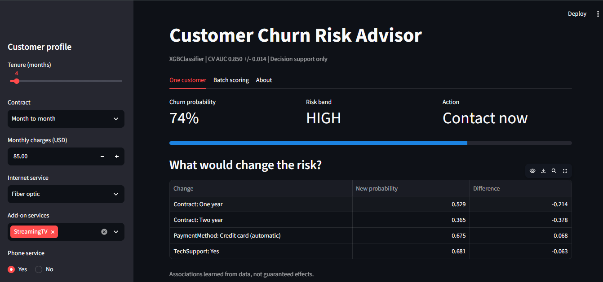
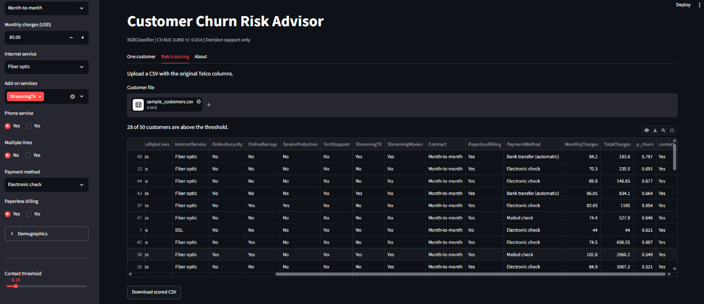

# Churn Risk Advisor

## Model card: Churn Risk Advisor v1.0

**Intended use:** rank existing telecom customers by churn risk so a retention team can prioritize calls. Decision support, not automation.

**Not for:** credit, pricing, or any decision that denies a service.

**Data:** IBM Telco Customer Churn, 7,043 customers, 26.5% churn.

**Model:** XGBClassifier, chosen by 5-fold CV. Features: 30 encoded columns.

**Performance:** CV AUC 0.850 +/- 0.014; test AUC 0.848 (test set used once).

**Threshold:** 0.15, from a cost analysis (FN = PKR 6,000, FP = PKR 1,000).

**Limitations:** one US dataset from one period; no Pakistan data; associations, not causes; performance may drift as plans change.

**Fairness check (Week 15):** compare recall across gender and seniors.

**Owner and version:** Zubeda Raheem, v1.0, 10 October 2026.

## Live app

https://zubeda-churn-risk-advisor.streamlit.app

## Screenshots




## Run locally

```
mkdir churn-risk-advisor
cd churn-risk-advisor
python -m venv .venv
.venv\Scripts\activate
pip install -r requirements.txt
streamlit run app.py
```

(Mac/Linux: `source .venv/bin/activate`)

## Notebooks

Week 1 to 3 notebooks: https://github.com/zubedaraheem1307-design/applied-ai-project1-churn

App repository: https://github.com/zubedaraheem1307-design/churn-risk-advisor

## Write it

### Part 1: skew demo, parity, what-if
I scored one customer with a two-year contract in two ways. With the Week 3 feature code (drop_first=True), the model gave P(churn) = 0.133. With my serving encoder, it gave 0.012. The reason is that a single row contains only one Contract value, so drop_first removes it and both Contract columns become 0. The model then treats the customer as Month-to-month, and no error is shown.

The parity test passed for all 7,043 customers. The largest difference between the training-style and serving-style predictions was 0.0.

In the what-if table for the riskiest customer (baseline P(churn) = 0.942), switching to a Two year contract reduced the risk the most, down to 0.753 (-0.189). One year gave 0.875 and Credit card payment gave 0.923. This does not prove that offering a two-year contract would keep the customer. The model only learned patterns from past customers, and people who choose long contracts may already be more loyal.

### Part 2: using the app
**Surprised me:** One customer with the same 8% churn probability gets "Contact now" at a threshold of 0.05, "WATCH" at 0.10 and "No action" at 0.15. The probability stays the same and only the decision rule changes. So choosing the threshold is as important as building the model.

**Handled badly:** The app lets a user pick unrealistic combinations, for example Internet service = No with monthly charges of $85. It still shows a confident result (3%) with no warning, so someone could trust a number that makes no sense.

### Part 3: deployment
**Public URL:** https://zubeda-churn-risk-advisor.streamlit.app

**Deployment:** The first deployment worked with no errors.

Streamlit's Advanced settings defaulted to Python 3.14, but I trained the model with scikit-learn 1.6.1 and XGBoost 3.2.0, so I changed Python to 3.11 to match the pinned versions. I then opened the app in a private browser window. It loaded without a login, and the batch tab flagged 28 of 50 sample customers, the same as on my laptop.

## Check your understanding

1. When I score a single customer, `drop_first=True` removes the only category present, so both Contract columns become 0 and the model reads the customer as Month-to-month. There is no error, but the prediction is wrong: my two-year customer got 0.133 instead of 0.012.

2. It compares the model's predictions on the training-style features with its predictions from my serving encoder (`prepare_input`) on the raw data. It has to use every row, because a mismatch might only show up for rare categories or unusual values that a small sample would miss. Mine passed on all 7,043 customers with a largest difference of 0.0.

3. `st.cache_resource`. The model is one big object that should be loaded once and reused for every click and every user. `st.cache_data` is meant for data such as DataFrames and copies it each time, which does not suit a model.

4. TotalCharges is basically tenure times monthly charges, so making the user type it is extra work and could produce combinations the model never saw. The app calculates it so the three values always agree.

5. A model file is tied to the library version that saved it. With a different scikit-learn version, it may fail to load or give different predictions without warning. I pinned scikit-learn 1.6.1 and XGBoost 3.2.0 so the server matches training.

6. Not necessarily. The model only shows an association: customers who choose two-year contracts may already be more loyal. In my what-if, the risk drops from 0.942 to 0.753. To find out, the company could run an A/B test: offer the contract to a random group of at-risk customers and compare their churn with a control group.
